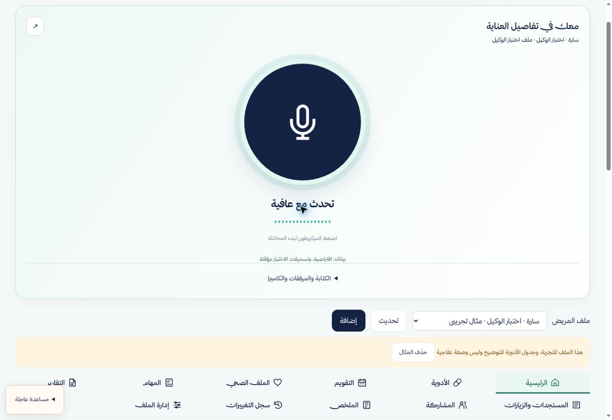
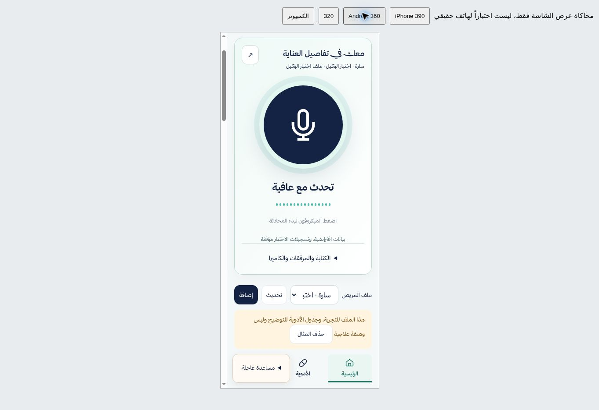

# دمج الوكيل داخل عافية

2026-10-17 — فرع work/integrated-care-agent، غير منشور على main

## المنجز
- تعديل app.js وdata.js وindex.html الحاليين، وليس استبدالهما بمعاينة محاكية
- الميكروفون أعلى المتابعة، 280px للكمبيوتر و200px للجوال، وإدخال ثانوي مطوي
- نفس جلسة الصوت أثناء إعادة رسم الواجهة والتنقل/التصغير؛ تتوقف عند تبديل المريض/الحساب
- ملف اختبار جديد في الذاكرة داخل قائمة المرضى. لا يرسل الملفات الحالية أو المثال السابق للمزوّد، ولا ينشئ سجلات Firebase
- أدوات منظمة للنموذج care_action: قراءة، ملخص، تنقل، مواعيد ومهام وملاحظات، جرعة وتصحيح وتراجع. تمر بالحفظ الحالي وقواعده. تعديل العلاج مستبعد، وتصحيح الجرعة وتعديل السجلات يتطلبان بطاقة مراجعة
- فصل أحداث التناول والتسجيل والتوقيت بالمحافظة على وظائف data.js
- الهوية والخطوط والفوتر والشعار دون تعديل، ولا رابط للسيرة الذاتية
- فرع رجوع backup/before-agent-integration-20261017 عند 3a8a258f0d6929aa054cf2478cbe442a2b31035d

## تشخيص الاتصال بالدليل
اختبارات HTTP غير مولدة لرموز ولا مستهلكة للنموذج، وليست طلبات من متصفح عافية المنشور:

| الطلب | النتيجة |
| --- | --- |
| OPTIONS مع Origin raw.githack.com | 403 بلا تفاصيل تفسيرية |
| OPTIONS مع Origin almohammdin.github.io | 204، Allow-Origin يطابق النطاق وAllow-Headers يشمل X-Firebase-AppCheck |
| POST {} من النطاق الأصلي بلا App Check | 401، error=app-check-rejected، detail=missing-app-check |

النطاق الأصلي مسموح في CORS. لم نثبت قبول App Check صالح أو رمز مستخدم؛ لم نقرأ سجل Worker الإداري أو متغيراته أو مشروع فوترة Gemini الفعلي. لا حاجة مثبتة لتعديل Cloudflare. لا توسعة لنطاق raw.githack أو تجاوز حماية.

## قبل تفعيل الصوت
- connection.enabled=false، لا تحميل reCAPTCHA ولا SDK الصوت ولا إصدار رمز تلقائيا
- يلزم قراءة إعداد خدمة mesraah-live-token ومشروع Gemini المرتبط وفوترته لتحديد مسار المعالجة والتكلفة. إعداد Firebase App Check العام الظاهر في مصدر المنصات لا يثبت مشروع مفتاح Gemini المخفي في Worker
- يلزم موافقة على تعديلات CSP التالية، ثم تفعيل اختبار الصوت فقط ونشر التغييرات على العنوان الأصلي. لم تطبق هذه التغييرات حاليا:
  - script-src: إضافة https://cdn.jsdelivr.net لتحميل SDK المثبت الإصدار 2.14.0، وhttps://www.google.com/recaptcha/ لتحقق Enterprise
  - connect-src: إضافة https://mesraah-live-token.naif123456.workers.dev وwss://generativelanguage.googleapis.com، وhttps://www.google.com/recaptcha/
  - frame-src: إضافة https://www.google.com/recaptcha/ لتحدي التحقق
  - media-src: self وblob للعرض المحلي إن احتاج المتصفح ذلك
  - gstatic وgoogleapis موجودان بالفعل؛ لا wildcard جديد ولا unsafe-eval ولا تغيير لقواعد Firebase
- أثر CSP: السماح بتحميل SDK وتحقق reCAPTCHA والاتصال بوسيط الرمز وبـ Gemini Live فقط. لا يمنح النموذج قراءة الملفات الأصلية؛ الحاجز في أدوات التطبيق مستقل
- اختبار App Check صالح من العنوان الأصلي يتطلب نشر الكود المعتمد أولا؛ لا يمكن الادعاء باختباره من هذا العنوان قبل النشر
- شروط Gemini Developer API راجعت اليوم: الخدمات غير المدفوعة تمنع إرسال المعلومات الشخصية/الحساسة؛ تنظيم التجربة الافتراضية لا يجيز تشغيل ملفات مرضى حقيقية. لم يتحقق تفعيل الفوترة أو شروط الاحتفاظ الخاصة بالحساب

## التحقق وحدوده
- 58 اختبارا آليا ناجحا في INTEGRATED-TEST-OUTPUT.txt؛ العدد يشمل الاختبارات القديمة، لا يعني 58 اختبارا للصوت الحقيقي
- 11 اختبار دمج جديد مع data.js الأصلي: عزل، هوية، اطلاع فقط، حفظ، تراجع، جرعة مكررة، سياق الواجهة، عدم تغيير العلاج
- اختباران إضافيان لاتصال Live مع SDK وميكروفون محاكيين: كتم، مقاطعة، إنهاء tracks ورفض نتائج/أذونات متأخرة
- Chrome فعلي داخل بيئة الاختبار: الاستكشاف، ملف الوكيل، الميكروفون الكبير، المطوية، تنقل الأدوية والعائمة
- قياس عرض 390: المساحة 375 وscrollWidth=375؛ عرض 360: المساحة 345 وscrollWidth=345؛ هذه محاكاة عرض داخل Chrome، ليست Safari أو iPhone/Android حقيقيين
- لم يبدأ اتصال Gemini حقيقي، لم يسمع رد مزود، لم تنتج عينة صوت سعودية، ولم تختبر كاميرا جهاز حقيقي
- فتح المرفقات وزر الكاميرا جاهزان، الكاميرا محلية ولا تبث للنموذج. فحص hash لملفات الاختبار فقط؛ استخراج المستندات في الواجهة المدمجة لم يفعل بعد
- منع التكرار في الملف المعزول داخل جلسة المتصفح؛ لا مزامنة أجهزة للسجل الافتراضي. الاختبارات السابقة لتزامن SQLite لا تثبت تشغيل التزامن في هذه الواجهة
- سجل الاختبار مؤقت؛ ليس تخزينا صحيا دائما. أدوات الإنتاج غير مفعلة ولا تدعي صلاحيات خادم للبيانات التجريبية المحلية
- لا إشعارات أو بريد حقيقي، ولا تعديل Firebase، ولا رسوم فعّلت

## المراجعة

لا تدمج main حتى مراجعة المستخدم. الرجوع بعد اعتماد نشر لاحق يكون باستعادة فرع النسخة الاحتياطية؛ لا يتطلب حذف بيانات أو قواعد.

حذفت ملفات المعاينة المستقلة المولدة preview/web وسكربت توليدها من هذا الفرع، وتبقى محفوظة في فرع المعاينة السابق للرجوع. مجلد preview المتبقي يحتوي اختبارات ومرجع التنفيذ المحلي، ولا يحمّل كواجهة ثانية داخل المنصة.

## مراجعة توافق الصوت 2026-10-18

الكود المرسل لخدمة mesraah-live-token يصدر الرموز من v1beta ويعلن apiVersion v1beta. صححنا عميل عافية من v1alpha إلى v1beta حسب وثائق Google الحالية، وأضفنا تحقق إصدار الاتصال إلى اختبار النقل المحاكى.

هذا تصحيح توافق، وليس إثباتا لسبب 403 أو نجاح صوت حقيقي. نطاق الخدمة وApp ID في المصدر يتطابقان مع إعداد اتصال عافية. لم نغير الخدمة المشتركة أو الحماية أو CSP أو enabled:false. يلزم التحقق من خطة مشروع مفتاح Gemini قبل تشغيل تجربة فعلية؛ المصدر وحده لا يحدد الفوترة.

المصدر: https://ai.google.dev/gemini-api/docs/live-api/ephemeral-tokens
